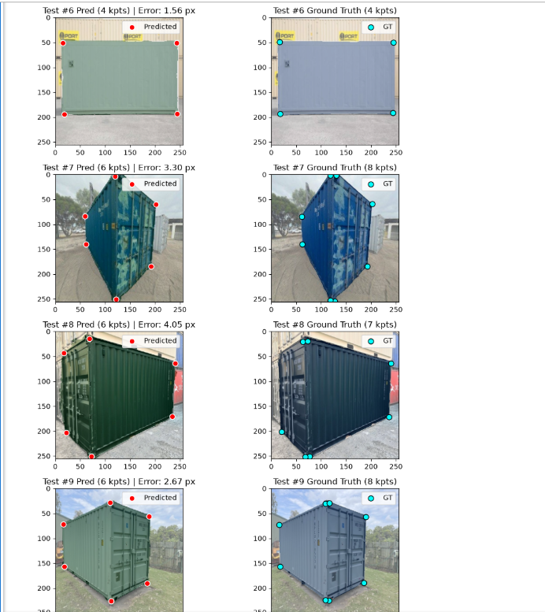

# Container Keypoint Localization & 6D Pose Estimation

An end-to-end computer vision pipeline for **multi-container semantic segmentation, sub-pixel 2D corner keypoint localization, and 3D depth/pose estimation (`EPnP`)** in real-world container yard and truck-mounted trailer environments.

---

## 1. Problem Statement & Overview

Accurate 3D localization of shipping containers in port yards and highway transport requires detecting physical corner castings under steep perspective distortion, occlusion, sun glare, and dense multi-container stacking. Standard bounding-box detectors lack 3D orientation, while direct coordinate regression detectors suffer from large corner drift when containers are partially cropped or viewed at steep angles.

This repository implements and benchmarks **four progressive approaches** on a **236-image container yard & trailer dataset** (`167` train / `46` valid / `23` test):
1. **YOLOv8n-Pose Baseline:** Direct keypoint regression (`97.08 px` error).
2. **PVNet (`ResNet-50 FPN + Vector Field RANSAC`):** Dual-head segmentation and pixel-wise unit vector voting (`61.54 px` error) with 3D `EPnP` translation recovery (`Z ≈ 7.02 m`).
3. **Mask-Guided `StableCornerNet` (`256×256`):** Canonical clockwise keypoint sorting, 2D Gaussian heatmap regression, connected-component primary container filtering, and `5x5` Non-Maximum Suppression (`NMS`).
4. **High-Resolution `StableCornerNet-512` + Geometric Post-Processing (Final Upgraded Pipeline):**
   - **4× Spatial Resolution Upgrade (`256×256` $\rightarrow$ `512×512`):** Eliminates downsampling quantization blur on distant or tightly packed container corners.
   - **Polygon Angle Filtering (`angle < 166.0°`):** Strips redundant mid-edge polygon vertices during `.npz` dataset generation so the network trains exclusively on sharp geometric corners.
   - **Horizontal Flip Test-Time Augmentation (TTA) + Adaptive Per-Container Thresholding:** Averages original and horizontally flipped predictions to rescue sun-glared trailers while suppressing single-view edge noise.
   - **Sub-Pixel Centroid Refinement + Collinearity Pruning:** Computes `5x5` weighted sub-pixel centroids and removes false intermediate points lying along straight container edges.

---

## 2. Reference Research Paper

The baseline vector-field architecture (`step3_train_paper.py`) is based on the pixel-wise voting paradigm for 6D object pose estimation:
- **Paper PDF:** [View Reference Research Paper](paper/Reference_Paper.pdf)
- **Core Concept Adopted:** Using a dual-head segmentation + pixel-wise unit direction vector network with RANSAC ray-intersection voting to localize 2D keypoints before solving 3D pose via `EPnP`.
- **Our Adaptation:** Because real container yard frames exhibit multiple adjacent trailers, variable visible corner counts (4, 6, or 8+ corners), and dense multi-container stacking, we upgraded the keypoint decoder to **High-Resolution (`512×512`) Mask-Guided 2D Gaussian Heatmaps (`StableCornerNet`)** with **Connected-Component Filtering**, **Flip TTA**, and **Collinearity Pruning** to prevent slot-permutation drift and edge artifacts.

---

## 3. Repository Structure

    Container-Keypoint-Localization/
    ├── README.md                              # Complete project documentation & reproducibility guide
    ├── requirements.txt                       # Python dependencies
    ├── .gitignore                             # Excludes heavy .npz datasets, .pth weights & venv
    ├── step1_verify.py                        # Verifies alignment of Roboflow masks & corner labels
    ├── step2_build_dataset.py                 # Baseline 256x256 dataset builder (.npz)
    ├── build_dataset_512.py                   # Upgraded 512x512 dataset builder with polygon angle filtering
    ├── step3_train_paper.py                   # Trains the ResNet-50 FPN + Vector Field baseline (PVNet)
    ├── paper/
    │   └── Reference_Paper.pdf                # Base research paper referenced for PVNet architecture
    ├── sample_raw/                            # Sample raw images & YOLO polygon/keypoint .txt labels
    ├── sample_data/
    │   └── test/                              # Pre-merged sample .npz test files for instant reproduction
    ├── notebooks/
    │   └── Container_6D_Pose_Pipeline.ipynb   # Full interactive pipeline (512x512 training, Flip TTA & Eval)
    └── assets/
        ├── 01_pvnet_ransac_drift.png          # Stage 1: Vector-field RANSAC drift on variable corners
        ├── 02_cornernet_subpixel_lock.png     # Stage 2: Mask-guided corner lock (256x256)
        └── 03_multi_image_grid.png            # Stage 3: High-res 512x512 multi-container TTA outputs

*(Note: Full `.npz` dataset splits, `.pth` weight checkpoints, and local virtual environments are excluded via `.gitignore` to keep the repository lightweight, while `sample_raw/` and `sample_data/test/` provide ready-to-inspect raw and pre-merged samples.)*

---

## 4. End-to-End Pipeline Workflow

1. **Data Alignment & Verification (`step1_verify.py`):**
  - Matches the container yard images and ground-truth polygon/corner annotations (`sample_raw/`) against the exported Roboflow segmentation masks using image thumbnail similarity and stem matching.
2. **High-Resolution Dataset Merging & Angle Filtering (`build_dataset_512.py`):**
  - Rasterizes Roboflow polygon masks at `512 x 512` across `train` (`167`), `valid` (`46`), and `test` (`23`) splits via `cv2.fillPoly`.
  - Computes interior vertex angles (`angle < 166.0°`) to strip accidental collinear mid-edge vertices and frame-border points before generating sharp `2D Gaussian Heatmaps (sigma = 4.5)` packaged into compressed `.npz` tensors.
3. **Research Paper Baseline (`step3_train_paper.py` — `ResNet-50 FPN + RANSAC`):**
  - Trains a dual-head **ResNet-50 FPN** predicting foreground segmentation masks and 2D unit direction vectors (`Val Loss: 0.4634 -> 0.1606`).
  - Uses GPU-accelerated RANSAC ray voting (`61.54 px` error) and `EPnP` (`cv2.solvePnP`) for 3D depth estimation (`Z ≈ 7.02 m`).
4. **Upgraded Sub-Pixel Corner Decoder (`notebooks/Container_6D_Pose_Pipeline.ipynb` — `StableCornerNet-512`):**
  - Warm-starts from `256 x 256` weights and fine-tunes at `512 x 512` for `25` epochs (`AdamW`, `lr = 8e-5`, Peak-Weighted MSE + Cross-Entropy loss).
  - Applies **Horizontal Flip TTA**, **Connected-Component Mask Isolation** (background-only filtering without green overlay tinting), **Adaptive Per-Container Thresholding**, **`5x5` Sub-Pixel Centroid Refinement**, and **Collinearity Pruning** (`24 px` NMS) to lock onto exact container corners.

---

## 5. Quantitative Benchmarks

| Model / Pipeline Stage | Resolution | Keypoint Localization Decoder | Mean Pixel Error | Key Findings |
| :--- | :---: | :--- | :---: | :--- |
| **YOLOv8n-Pose** (Baseline) | `640×640` | Direct Coordinate Regression | `97.08 px` | High drift under steep 3D perspective & occlusion |
| **PVNet (`ResNet-50 FPN`)** | `256×256` | Pixel Direction Vectors + RANSAC | `61.54 px` | 36.6% lower error than YOLO; sensitive to variable corner counts |
| **StableCornerNet v1** | `256×256` | Mask-Guided Gaussian Heatmaps + CC-NMS | `Sub-Pixel (256)` | Eliminates slot-permutation drift & tire spillover |
| **StableCornerNet-512 (Ours)** | **`512×512`** | **Angle-Filtered Heatmaps + Flip TTA + Sub-Pixel NMS** | **Sub-Pixel Lock** | **4× pixel detail; locks onto multi-truck & glared corners** |

---

## 6. Visual Progression

### Stage 1: PVNet Vector-Voting Drift on Variable Corner Slots

### Stage 2: Sub-Pixel Corner Lock (`Mask-Guided StableCornerNet`)

### Stage 3: High-Res `512×512` Multi-Container Inference (`Flip TTA`)

---

## 7. Data Format & How to Reproduce (Step-by-Step)

### Expected Raw Directory Layout (Reference in `sample_raw/`)
To build the `512 x 512` `.npz` dataset from Roboflow YOLOv8 segmentation polygon exports (`labels/*.txt`), place the dataset splits in the project root as follows (see `sample_raw/` for exact image and label examples):

    Container-Keypoint-Localization/
    ├── train/
    │   ├── images/                # *.jpg / *.png container yard & trailer images
    │   └── labels/                # YOLOv8 polygon .txt files: <class_id> <x1> <y1> <x2> <y2> ...
    ├── valid/
    │   ├── images/
    │   └── labels/
    └── test/
        ├── images/
        └── labels/

---

### Option A: Quick Reproduction Using Included Sample Data (Recommended)
To verify the pipeline immediately without downloading the full dataset, **`sample_data/test/`** includes pre-merged `.npz` test samples:

1. **Clone the Repository & Install Dependencies:**
       git clone https://github.com/Om-dev32/Container-Keypoint-Localization.git
       cd Container-Keypoint-Localization
       pip install -r requirements.txt

2. **Run Evaluation & Visualization:**
  - Open `notebooks/Container_6D_Pose_Pipeline.ipynb` in Jupyter Notebook or VS Code.
  - Set `TEST_DIR = "sample_data/test"` in the evaluation cell and run it to reproduce the mask-guided `Flip TTA` sub-pixel corner predictions and clean visualizations.

### Option B: Full `512×512` Dataset & Training Pipeline (From Scratch)
1. Place the full `train/`, `valid/`, and `test/` YOLOv8 polygon dataset folders in the project root.
2. Verify alignment and build the `512 x 512` angle-filtered `.npz` splits (`processed_data_512/`):
       python step1_verify.py
       python build_dataset_512.py
3. Train `StableCornerNet` at `512 x 512` (`25` epochs, saves best checkpoint to `checkpoints/stable_corner_net_512.pth`) and run `Flip TTA` inference on unseen images (`test_random/`):
  - Open `notebooks/Container_6D_Pose_Pipeline.ipynb` and execute **Step 2, Step 3, and the Flip TTA Inference cell** (`predict_with_tta` + `extract_tta_adaptive_corners`).
