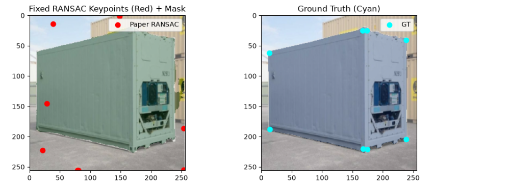
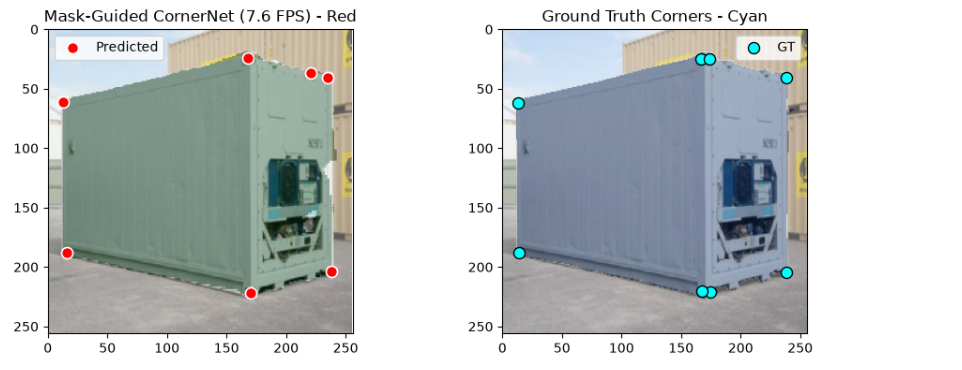

# Container Keypoint Localization & 6D Pose Estimation

An end-to-end computer vision pipeline for **multi-container semantic segmentation, sub-pixel 2D corner keypoint localization, and 3D depth/pose estimation using EPnP** in real-world container yards and truck-mounted trailer environments.

The project explores multiple approaches, progressing from direct keypoint regression to pixel-wise vector voting and high-resolution, mask-guided corner localization.

---

## 1. Problem Statement

Accurate 3D localization of shipping containers in port yards and highway transport environments requires identifying physical container corners despite:

- Strong perspective distortion and varying camera viewpoints
- Partial occlusion and cropped containers
- Sun glare and changing illumination
- Multiple adjacent containers and dense trailer scenes
- Variable numbers of visible corners

Standard bounding-box detectors do not provide the corner-level geometry required for pose estimation. Direct keypoint regression can also produce significant corner-location errors under challenging viewpoints.

This repository implements and benchmarks four progressive approaches using a **236-image container yard and trailer dataset**:

| Split | Images |
|---|---:|
| Training | 167 |
| Validation | 46 |
| Testing | 23 |
| **Total** | **236** |

### Implemented approaches

1. **YOLOv8n-Pose baseline** — Direct keypoint coordinate regression. Reported mean pixel error: **97.08 px**.
2. **PVNet (ResNet-50 FPN + Vector Field RANSAC)** — Dual-head segmentation and pixel-wise unit direction-vector prediction, followed by RANSAC voting. Reported mean pixel error: **61.54 px**. The pipeline also demonstrates EPnP-based translation recovery (`Z ≈ 7.02 m`).
3. **Mask-Guided StableCornerNet (256×256)** — Canonically ordered keypoints, 2D Gaussian heatmap regression, connected-component container filtering, and 5×5 non-maximum suppression (NMS).
4. **StableCornerNet-512 (upgraded pipeline)** — High-resolution heatmap prediction combined with geometric post-processing:
   - **512×512 input resolution:** A 2× increase in width and height over the 256×256 version, providing 4× as many spatial positions.
   - **Polygon angle filtering:** Filters vertices with an interior angle below `166°` during dataset preparation to remove unwanted intermediate edge points.
   - **Horizontal-flip test-time augmentation (TTA):** Combines predictions from the original and horizontally flipped images.
   - **Adaptive per-container thresholding:** Helps separate valid corner responses from background noise.
   - **Sub-pixel centroid refinement:** Uses a 5×5 weighted neighborhood to refine predicted corner locations.
   - **Collinearity pruning:** Removes redundant points along straight container edges using a 24 px NMS distance.

---

## 2. Reference Research

The PVNet-style baseline in `step3_train_paper.py` follows a pixel-wise voting approach for object pose estimation.

- **Reference paper:** [`paper/Reference_Paper.pdf`](paper/Reference_Paper.pdf)
- **Core approach:** A dual-head network predicts foreground segmentation and pixel-wise unit direction vectors. RANSAC ray-intersection voting is then used to estimate 2D keypoint locations, followed by EPnP for 3D pose estimation.
- **Project adaptation:** Real container-yard scenes can contain multiple adjacent trailers and a variable number of visible corners (4, 6, or 8+). The later StableCornerNet pipeline therefore uses mask-guided Gaussian heatmaps, connected-component filtering, flip TTA, and geometric post-processing to improve corner localization in these scenes.

---

## 3. Repository Structure

```text
Container-Keypoint-Localization/
├── README.md
├── requirements.txt
├── .gitignore
├── step1_verify.py
├── step2_build_dataset.py
├── step3_train_paper.py
├── paper/
│   └── Reference_Paper.pdf
├── sample_raw/
│   └── ...                         # Sample images and annotation files
├── sample_data/
│   └── test/                       # Pre-processed sample .npz test data
├── notebooks/
│   ├── Container_6D_Pose_Pipeline.ipynb
│   └── Fine tune Container_6D_Pose_Pipeline.ipynb
└── assets/
    ├── 01_pvnet_ransac_drift.png
    ├── 02_cornernet_subpixel_lock.png
    └── 03_multi_image_grid.png
```

### Important files

| File | Purpose |
|---|---|
| `step1_verify.py` | Verifies alignment between source images, polygon annotations, and exported segmentation masks. |
| `step2_build_dataset.py` | Builds the baseline 256×256 dataset tensors. |
| `step3_train_paper.py` | Trains the ResNet-50 FPN vector-field baseline (PVNet-style approach). |
| `Container_6D_Pose_Pipeline.ipynb` | Contains the baseline pipeline, StableCornerNet 256×256 workflow, evaluation, and EPnP demonstration. |
| `Fine tune Container_6D_Pose_Pipeline.ipynb` | Contains the upgraded 512×512 preprocessing, fine-tuning, and flip-TTA inference workflow. |

> **Repository note:** Full processed `.npz` dataset splits, `.pth` model checkpoints, and local virtual environments are excluded through `.gitignore` to keep the repository lightweight. Sample raw data and pre-processed test samples are included for inspection and quick evaluation.

---

## 4. End-to-End Pipeline

### Stage 1 — Data alignment and verification

**Script:** `step1_verify.py`

- Matches container-yard images and polygon/corner annotations in `sample_raw/` with exported Roboflow segmentation masks.
- Uses image thumbnail similarity and filename-stem matching to verify the corresponding files.

### Stage 2 — Baseline dataset and research model

**Scripts:** `step2_build_dataset.py`, `step3_train_paper.py`

- Builds 256×256 `.npz` tensors for the vector-field approach.
- Trains a dual-head ResNet-50 FPN network to predict foreground segmentation and pixel-wise unit direction vectors.
- Uses RANSAC ray voting to estimate keypoint locations.
- Applies `cv2.solvePnP` with EPnP to estimate 3D translation.

Reported results include validation loss changing from `0.4634` to `0.1606`, a mean pixel error of `61.54 px`, and an estimated depth of approximately `7.02 m` for the reported example.

### Stage 3 — Mask-guided StableCornerNet (256×256)

**Notebook:** `notebooks/Container_6D_Pose_Pipeline.ipynb`

- Introduces canonical clockwise keypoint ordering.
- Generates and predicts 2D Gaussian keypoint heatmaps.
- Uses connected-component filtering to isolate the primary container region.
- Applies 5×5 NMS to identify corner responses and reduce duplicate detections.

### Stage 4 — High-resolution fine-tuning (512×512)

**Notebook:** `notebooks/Fine tune Container_6D_Pose_Pipeline.ipynb`

**Step 1: Dataset preprocessing**

- Rasterizes Roboflow polygon masks using `cv2.fillPoly`.
- Filters polygon vertices using the configured angle condition (`angle < 166.0°`).
- Generates 2D Gaussian corner heatmaps with `sigma = 4.5`.
- Saves the processed 512×512 data under `processed_data_512/`.

**Steps 2–3: Model fine-tuning**

- Warm-starts StableCornerNet from the 256×256 model weights.
- Fine-tunes at 512×512 for 25 epochs.
- Uses AdamW with a learning rate of `8e-5`.
- Uses Peak-Weighted MSE and Cross-Entropy loss.
- Saves the best checkpoint to `checkpoints/stable_corner_net_512.pth`.

**Step 4: Flip-TTA inference and geometric refinement**

- Runs inference on the original and horizontally flipped images.
- Combines the predictions using horizontal-flip TTA.
- Applies background connected-component filtering and adaptive per-container thresholding.
- Refines corner positions using 5×5 weighted sub-pixel centroids.
- Applies collinearity pruning with a 24 px NMS distance.

---

## 5. Quantitative Benchmarks

The following values are the reported results from the project experiments.

| Model / Pipeline | Resolution | Localization method | Mean pixel error / result | Observation |
|---|---:|---|---:|---|
| YOLOv8n-Pose baseline | 640×640 | Direct coordinate regression | **97.08 px** | Corner drift under strong perspective and occlusion. |
| PVNet (ResNet-50 FPN) | 256×256 | Pixel direction vectors + RANSAC | **61.54 px** | 36.6% lower reported error than the YOLOv8n-Pose baseline; sensitive to variable corner counts. |
| StableCornerNet v1 | 256×256 | Mask-guided Gaussian heatmaps + connected-component filtering + NMS | Sub-pixel refinement | Reduces slot-ordering issues and unwanted detections around container/trailer regions. |
| StableCornerNet-512 | 512×512 | Angle-filtered heatmaps + flip TTA + sub-pixel refinement | Sub-pixel refinement | Adds higher spatial detail and geometric post-processing for multi-container scenes. |

**Metric note:** The numeric mean pixel errors are reported for the YOLOv8n-Pose and PVNet experiments. The StableCornerNet rows describe the implemented refinement pipeline; a directly comparable numeric mean pixel error is not specified here.

---

## 6. Visual Results

The repository's `assets/` directory contains visual examples of the pipeline's progression.

### Stage 1 — PVNet vector-voting results



### Stage 2 — Mask-guided StableCornerNet results



### Stage 3 — High-resolution 512×512 multi-container inference


---

## 7. Dataset Access

The project uses a **236-image annotated dataset** exported in YOLOv8 segmentation format.

- **Dataset:** [Download Container Segmentation Dataset from Roboflow](https://app.roboflow.com/ds/SFiEJndkHs?key=aFFQifyhKj)
- **Training split:** 167 images
- **Validation split:** 46 images
- **Test split:** 23 images
- **Annotation format:** YOLOv8 polygon segmentation:
  `class_id x1 y1 x2 y2 ...`
- **Coordinates:** Polygon coordinates are normalized to the range `[0, 1]`.

After downloading and extracting the dataset, the expected directory layout is:

```text
Container-Keypoint-Localization/
├── train/
│   ├── images/
│   └── labels/
├── valid/
│   ├── images/
│   └── labels/
└── test/
    ├── images/
    └── labels/
```

Each split should contain its corresponding images and YOLO-format polygon label files.

---

## 8. Setup

### Requirements

- Python environment compatible with the packages listed in `requirements.txt`
- Git
- Jupyter Notebook or VS Code with Jupyter support
- Dataset files for full preprocessing and training
- A CUDA-enabled GPU is recommended for model training; CPU execution may be slower

### Clone the repository

```bash
git clone https://github.com/Om-dev32/Container-Keypoint-Localization.git
cd Container-Keypoint-Localization
```

### Install dependencies

```bash
python -m venv .venv
```

Activate the environment:

**Windows**
```bash
.venv\Scripts\activate
```

**Linux / macOS**
```bash
source .venv/bin/activate
```

Install the project dependencies:

```bash
pip install -r requirements.txt
```

---

## 9. Reproduction Guide

### Option A — Quick evaluation with included sample data

Use this option to inspect the pre-processed test samples without downloading the complete dataset or running training.

1. Clone the repository and install dependencies using the setup instructions above.
2. Open `notebooks/Container_6D_Pose_Pipeline.ipynb` in Jupyter Notebook or VS Code.
3. In the evaluation cell, set:

   ```python
   TEST_DIR = "sample_data/test"
   ```

4. Run the relevant evaluation and visualization cells to inspect the mask-guided corner predictions.

This option is intended for quick inspection and evaluation of the included sample `.npz` files.

### Option B — Full 512×512 fine-tuning and inference (recommended)

Use this option to reproduce the upgraded high-resolution pipeline.

1. **Download the annotated dataset.**

   Download and extract the [Roboflow dataset](https://app.roboflow.com/ds/SFiEJndkHs?key=aFFQifyhKj) into the repository root. Ensure that `train/`, `valid/`, and `test/` each contain `images/` and `labels/` directories.

2. **Verify data alignment.**

   ```bash
   python step1_verify.py
   ```

3. **Open the fine-tuning notebook.**

   Open:

   ```text
   notebooks/Fine tune Container_6D_Pose_Pipeline.ipynb
   ```

4. **Run the notebook cells sequentially.**

   - **Step 1 — 512×512 preprocessing:** Generate segmentation masks and angle-filtered corner heatmaps in `processed_data_512/`.
   - **Steps 2–3 — Model fine-tuning:** Fine-tune StableCornerNet for 25 epochs. The best checkpoint is saved to `checkpoints/stable_corner_net_512.pth`.
   - **Step 4 — Flip-TTA inference:** Run horizontal-flip TTA and adaptive per-container thresholding on the selected test images (the notebook's `test_random/` input).

5. **Verify the visual predictions.**

   Review the notebook plots and the generated results in `test_random_512_tta/`. Check whether background filtering suppresses unwanted tire/chassis responses and whether the refined corner predictions align with the visible container corners.

> Run the notebook cells in their intended order. If your local notebook uses different folder names or checkpoint paths, update the corresponding configuration cells to match your local project structure.

---

## 10. Notes and Reproducibility

- The reported benchmark values are experiment outputs and should be interpreted in the context of the dataset and evaluation setup used.
- The StableCornerNet results are described as sub-pixel refinement results in the current project documentation; no numeric mean pixel error is claimed for those rows.
- The full processed datasets and trained checkpoints are not included in the lightweight repository. They are generated during preprocessing and training.
- For reproducibility, use the same dataset version, split, image resolution, preprocessing settings, and evaluation procedure when comparing model results.

---
